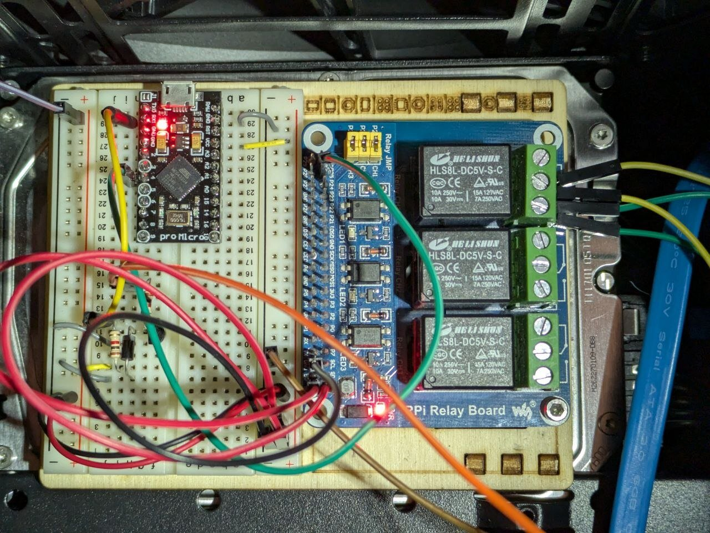
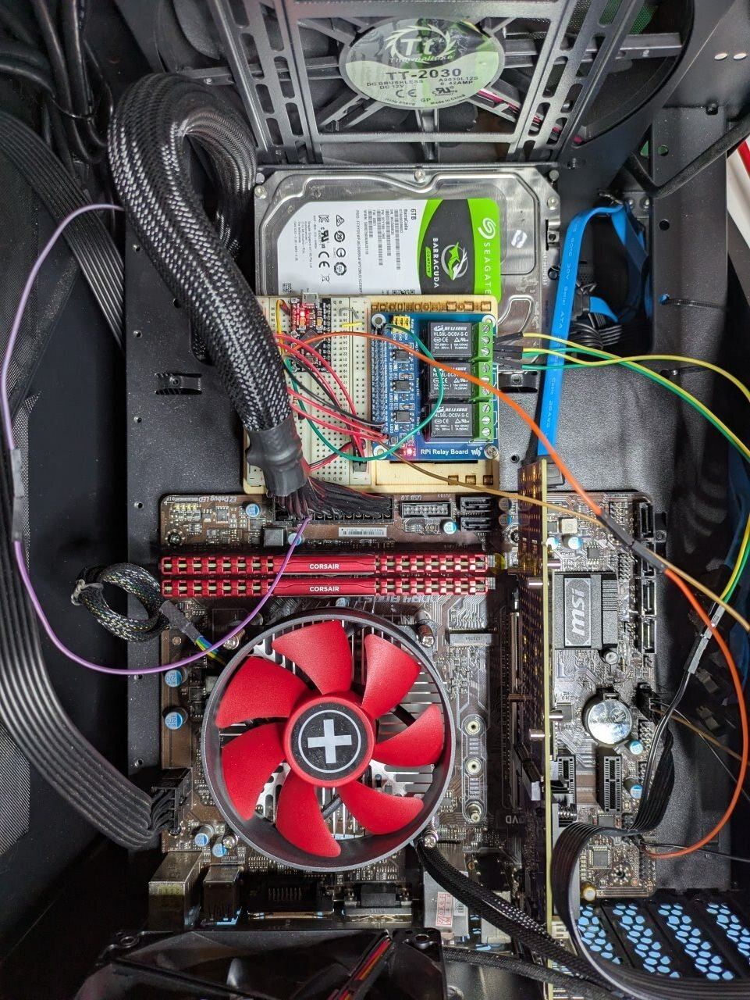
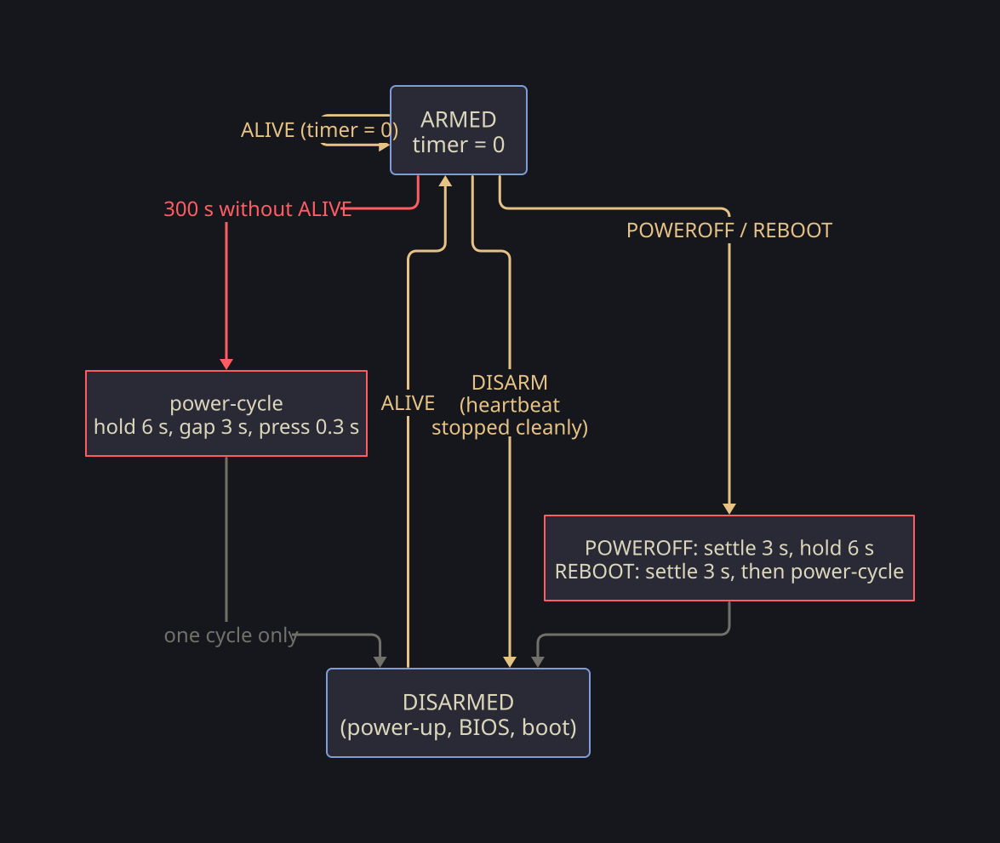

# atx-watchdog

> [!WARNING]
> Every line in this repo is vibe-coded: firmware, NixOS module, generators,
> docs. Read it before you trust it with your hardware.

A hardware watchdog for an ATX PC, built on a SparkFun Pro Micro: if the OS
stops saying it is alive, the firmware presses the power button for it.
Personal project.

**Why.** A short on the PSU killed the USB controller of the motherboard and broke the
handling of the power-off signal: the OS halts, the board stays on, and the
only remedy is a finger on the case button. The board still has a working
COM header (JCOM1) and the front-panel PWR SW pins (JFP1), which is enough:
a microcontroller listens on the COM port and presses the button.

**How.** JCOM1 TX goes through a one-transistor RS-232→TTL inverter into
the Pro Micro's `Serial1`; pin 4 shorts PWR SW (relay board in the proof of
concept, a BC547 in the final build). The Pro Micro runs from 5VSB, so it
stays up while the PC is off. See
[docs/poc/schematic.png](docs/poc/schematic.png) (schemdraw),
[docs/poc/wiring.png](docs/poc/wiring.png) and
[docs/final/wiring.png](docs/final/wiring.png) (d2, bench wiring),
[docs/BENCH.md](docs/BENCH.md). Each drawing also has an `.svg` next to it.

The proof of concept on the bench, and in the case:

<table><tr>
<td></td>
<td></td>
</tr></table>

## Watchdog

- **Arming.** The watchdog starts disarmed: power-up, BIOS and boot are
  never touched. The first `ALIVE` arms it, every `ALIVE` restarts the
  300 s timer.
- **Firing.** 300 s without `ALIVE`: hold PWR SW 6 s (the PCH forces off
  after 4 s), wait 3 s, short press. Then disarmed: a PC that cannot boot
  gets one power-cycle, not a loop. It re-arms on the next `ALIVE`.
- **Standing down.** `DISARM` turns it off without a power-cycle; the
  NixOS module sends it when the heartbeat service is stopped on purpose.
  A frozen sender says nothing, so it still fires.
- **Stale input.** Whatever arrives while the button is held is dropped:
  the 6 s hold reaches a live OS as a short press, and its own `POWEROFF`
  must not fire after the power-cycle.

The host side is `module.nix`. It sends `ALIVE` every 60 s, but only while
`systemctl is-system-running` says `running` or `degraded` and each of
`probeDirs` takes a synced write within `probeTimeout`. A hung pool or a
stuck boot therefore withholds `ALIVE` instead of faking it. With
`panicOnHang`, oopses, soft lockups and hung tasks become panics, which
stop the heartbeat for sure.

## COM port protocol

9600 8N1, one command per line (CR or LF), at most 15 characters.
Overlong lines are dropped whole and unknown lines are ignored, so boot
noise on the port never matches a command. The host sends a newline
before each command to end any partial line. JCOM1 is one-way: replies and
an echo of every line (`com: ...`, `usb: ...`) go to the USB console only.
The same commands are accepted on USB.

| command | what the firmware does | reply on USB |
|---|---|---|
| `ALIVE` | arm, restart the 300 s timer | none |
| `DISARM` | disarm | `disarmed` |
| `STATUS` | report | `watchdog: armed, last ALIVE s ago: N` / `watchdog: disarmed` |
| `PING` | nothing | `pong` |
| `POWEROFF` | disarm, wait 3 s, hold 6 s | `poweroff: settle, hold`, `done` |
| `REBOOT` | disarm, wait 3 s, hold 6 s, wait 3 s, press | `reboot: settle, hold, gap, press`, `done` |
| `PRESS` | short press (0.3 s) | `press`, `done` |
| `HOLD` | hold 6 s | `hold`, `done` |

`POWEROFF` and `REBOOT` cover this board's broken power-off: the module
sends them from a systemd shutdown hook, after everything is unmounted,
and the firmware finishes the job. `PRESS` and `HOLD` are for the bench and
for a person at the USB console.

## Install

Nix with flakes enabled, direnv (`use flake` in `.envrc`). `nix develop`
prints the available commands and installs the git hooks (lefthook.yml):
linters and formatters on commit, `nix flake check` on push.

Host side: import `nixosModules.default`, enable `services.atx-watchdog`,
see `module.nix` for the options.

## Two ideas worth stealing

**Generated, linted breadboards.** `src/fritzing/gen.py` places parts by
"this pin goes into that hole", using hole and pin coordinates from the
parts' own SVGs, and traces the resulting nets through the breadboard
strips against the schematic. Then `fzgen-lint` (`src/fzgen`) re-reads what
Fritzing actually rendered, so a pin that drifted off its hole or a wire on
the wrong row fails `nix flake check` instead of the bench.

**Tested firmware without hardware.** `test/sim.cpp` compiles the same
`.ino` against a fake Arduino core with a virtual clock and drives the
command parser, button timings and the watchdog state machine.
`test/vm.nix` boots the NixOS module in a VM and checks what reaches the
COM port on `poweroff`, `reboot` and a stopped heartbeat.

## Next

The proof of concept (relay board) runs in the case; after a week or two
of use:

- [ ] Final build: BC547 instead of the relay board (`flash-transistor`,
      stage B in [docs/BENCH.md](docs/BENCH.md)). Not built yet.
- [ ] 5VSB for good: today a Dupont pin sits in the back of the 24-pin
      plug. Replace it with a 24-pin extension tap or a soldered lead.
- [ ] Final schematic in KiCad.

## Agent mistakes so far

The sketches, drawings and code are written by an AI agent; these are its
errors, caught on the bench.

- Wired the relay board without reading its schematic: missed the `CH1`
  jumper and the 3V3 feed on header 1. Vendor schematics now live in
  `docs/schemas/`.
- Guessed the relay board's channel and terminal order (actually CH3, CH2,
  CH1 and NO, COM, NC) and drew it as fact. Unknowns are now measured on
  the part first.

## License

MIT, see [LICENSE](LICENSE). The vendor documents in `docs/schemas/` keep
their own terms (see the README next to each).
